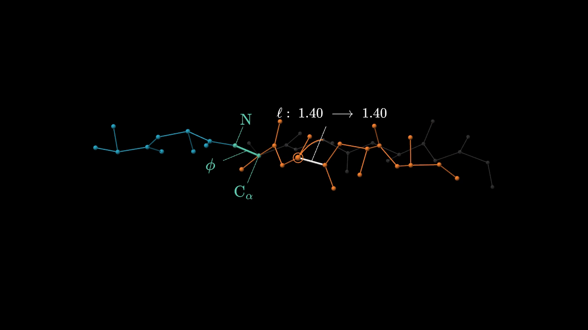

# Peptide torsion through the production pipeline

[Watch the 20.2-second demo](demo.mp4). It is silent, with optional embedded captions
and [SRT](demo.srt) / [WebVTT](demo.vtt) sidecars.



Six schematic residues form a 30-atom chain. One middle phi angle changes by 60°,
carrying 18 downstream atoms around a fixed N–C-alpha axis while 12 atoms stay
fixed. A faint original pose, one tracked atom's true circular arc and an unchanged
bond-length comparison make the operation visible. The fixed camera, stable role
colors, local math labels and persistent construction follow the user's approved
explanation-style baseline.

## What ran

This is an actual `createPiGenerator` run using `PiAgentRunner`, **gpt-6-astra / high**,
and the configured `openai-codex` provider. The pipeline created the lesson, reviewed
its instructions, generated subtitle timing, authored the scene, inspected three
candidates, validated the result and ran its native WebGPU visual review. No lesson
was seeded and no generated scene source was hand-edited. Generation took about
8.5 minutes. The final native visual review approved attempt 0.

The [custom request](request.json) supplied a visual contract rather than scene code.
The updated `capabilities.md` reached the real planner verbatim; the complete
`buildAuthoringReference(reference.md)` output reached the real scene author.
The [pipeline audit](pipeline-audit.json) records guide hashes and actual stage
metrics. The personal explanation-style skill was applied by the orchestrator and
independent visual reviewer, with its requirements translated into the request;
the production agent did not automatically load that personal skill file.

The author did not have the optional Chromium preview tool in this run. The final
native GPU visual gate did run, followed by separate numerical and visual reviews.
The supported subtitle-only mode exercised reading-time alignment and word-based
animation timing; speech synthesis was intentionally outside this run.

## Evidence and boundaries

| Check | Result |
| --- | --- |
| Exact source | [scene.js](scene.js), SHA-256 `70968c5345f11e026cddf1ca98494fdb0ed665ea158a8036ec90bb484458cc6f` |
| Pipeline provenance | [Independent review](pipeline-review.md), [audit](pipeline-audit.json), [record](provenance.json) |
| Geometry | [Independent review](geometry-review.md) and [measurements](geometry-review.json): 101 raw poses, 110 compiled frames, 117 reverse/nonmonotonic seeks |
| Visual acceptance | [Independent review](visual-review.md): reasoning, readability, reference style and technical delivery assessed separately |
| Delivery | Native WebGPU → H.264/yuv420p; 1280×720, 24 fps, 485 decoded frames, 20.208333 seconds; no audio |

Maximum measured bond-length error was 2.887e-15 model units. Axis and upstream
drift were zero. The audit checked compiled atom positions, surface-trimmed bond
endpoints, the original ghost, real circle geometry and the unchanged camera under
production VM limits. Visual review used actual native frames and ordered decoded
video samples; it does not claim continuous human playback or every-frame visual
inspection. Full video decoding separately checked encoding integrity.

The displayed `1.40 → 1.40` is an equality in idealized model length units. This is
an original schematic template with prescribed torsion, not a deposited protein,
physical dynamics, energy calculation or folding prediction. This single demo
tests the atomic-peptide recipe and associated timing, bindings, labels, connectors
and camera behavior. It does not validate every recipe, complex protein assembly,
external asset import, textures, narration or long-form orchestration.

## Re-render and recheck

From the repository root, with installed workspace dependencies and FFmpeg:

```powershell
node docs/demos/pipeline-peptide-20261011/export-generated.mjs --manifest docs/demos/pipeline-peptide-20261011/manifest.json --output data/pipeline-peptide-demo.mp4 --ffmpeg ffmpeg --width 1280 --height 720 --fps 24

node docs/demos/pipeline-peptide-20261011/verify-generated.mjs docs/demos/pipeline-peptide-20261011/scene.js data/pipeline-peptide-geometry.json
```

Pass an absolute FFmpeg executable path if it is not on `PATH`. The numerical
verifier expects this exact generated scene's local variables; it is an evidence
harness for this demo, not a general protein validator. Supply both file arguments
as shown. For an 8-second proof, append `--start 7.5 --end 15.5` to the export command.
These select the original absolute scene clock and shift only subtitle cue times.

The local [export adapter](export-generated.mjs) loads the existing native video
exporter and accepts only the production `subtitle-clock-<scene-id>` asset in an
explicit subtitle manifest. The stock silent CLI rejects any declared audio asset,
including this zero-audio timing clock. The adapter leaves scene bytes, geometry
and rendering unchanged, rejects arbitrary audio and fails if its exporter anchors
change. This is a demo-only host adapter, not a change to the production exporter.

Original prompts, candidate inspections, native review frames, generation harness
and complete logs remain in the local ignored directory
`data/animlib-expansion/pipeline-demo/`; job ID is
`872ef266-3328-4b6b-a520-c911f0952d69`. Review reports retain those original paths.
The files beside this README preserve the final source, request, media and evidence
needed to inspect or reproduce the final rendering without another model call.
