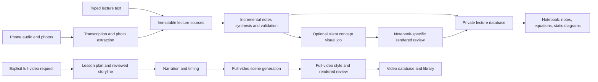

# Notes and full-video architecture

Notes and full videos are separate application workflows. They share a server,
authentication and rendering infrastructure, but neither calls the other's
generation pipeline. This is workflow isolation, not separate operating-system
processes or independent provider quotas.

## Notes creation

1. Text, transcribed audio and extracted photo evidence become
   immutable source chunks. Sources are saved before model work starts. Source IDs,
   ordering and capture metadata preserve provenance.
2. `LectureService` schedules notes work and tracks source and synthesis revisions.
   Ordinary updates send a new batch, prior notes and bounded continuity context.
   Explicit refreshes rebuild from the full source set. Personal edit anchors survive.
3. The notes agent uses its notebook instructions and source evidence, with external
   research disabled. Incremental output can be a sparse patch; the host expands
   compact arrays and references into the durable notes schema.
4. Validation checks source IDs, object identity, notebook structure, equations,
   diagrams and verbatim assignment wording. A bounded recovery loop repairs invalid
   output. Valid citations establish provenance, not proof that every claim is correct.
5. The result is saved in the private lecture database. The frontend polls revisioned
   snapshots and renders sections, equations, diagrams, photo snippets and edits.
6. Static diagrams need no video job. When notebook visuals are enabled, the first
   newly discovered dynamic concept can schedule a separate silent 12-second scene;
   others are requested explicitly. It has its own authoring, validation and rendered
   review policy. Notes remain available if a visual fails. Disabling visuals prevents
   automatic visual jobs while retaining concepts for later requests.

## Ownership boundary

| Concern | Notebook workflow | Full-video workflow |
| --- | --- | --- |
| Composition | `backend/src/lecture-workflow.ts` | `backend/src/video-workflow.ts` |
| Orchestration | `LectureService`, capture service | `VideoService`, video generator, narration service |
| Main output | Structured notes and private concept visuals | Planned, timed scenes and video library records |
| Main model | `LECTURE_MODEL` | `AGENT_MODEL` |
| Optional visual model | `LECTURE_VISUAL_MODEL`, optional `LECTURE_VISUAL_REVIEW_MODEL` | `AGENT_MODEL` |
| Enablement | `LECTURE_GENERATOR`, `LECTURE_VISUAL_GENERATOR`: `pi` or `disabled` | `VIDEO_GENERATOR`: `pi` or `simulated` |
| Style policy | Notes instructions; `lecture-visual*.md` | Video guidance, scene craft, verify/repair prompts and video style-reference image |
| Durable storage | `LECTURE_DB_PATH`, adjacent capture/Live databases | `VIDEO_DB_PATH`, narration storage |
| Temporary jobs | `LECTURE_AGENT_DATA_DIR` | `AGENT_DATA_DIR` |
| Preview queue | Notebook-owned browser/queue; `LECTURE_SCENE_PREVIEW` | Video-owned browser/queue; `SCENE_PREVIEW` |

The shared layer includes Pi authentication/transport, animlib's compiler and API
reference, the scientific catalog/assets, rendering and inspection machinery,
atomic persistence and the review/repair algorithm. Each workflow supplies its
own product policy. Notebook jobs do not load full-video craft/review prompts or
the video style-reference image. Shared persistence no longer imports narration.

Changing video generation mode, model, reasoning, scene timing/output mode, database
path or temporary job path does not configure notebooks. Both workflows still use
the same process, machine resources and configured provider account. Browser binary
and sandbox settings may be shared, with notebook-specific overrides available.

## Configuration and upgrades

Default lecture database: `data/lectures.sqlite`. Default private job root:
`data/lecture-agents`. Docker defaults, inherited by Compose, preserve the existing
`/data/videos/lectures.sqlite` location and place lecture jobs under
`/data/agents/lecture-jobs`. Compose does not override lecture paths supplied by
the runtime env file.

For a custom deployment that previously relied on `VIDEO_DB_PATH` to choose the
lecture directory, set `LECTURE_DB_PATH` to the existing adjacent `lectures.sqlite`
before restarting. Capture and Live database defaults then follow that lecture
directory. No database migration or automatic file move is performed.

To retain the previous all-AI-off demo behavior, set `VIDEO_GENERATOR=simulated`,
`LECTURE_GENERATOR=disabled` and `LECTURE_VISUAL_GENERATOR=disabled` explicitly.
To generate notes without animations, set only `LECTURE_VISUAL_GENERATOR=disabled`.

## Regression protection

`lecture-workflow.test.ts` exercises independent configuration and source-to-notes
processing with video generation simulated. `workflow-boundaries.test.ts` follows
emitted runtime imports in both directions and rejects cross-workflow orchestration
dependencies. Lecture visual and review tests verify mandatory review, independent
policy through repairs, and absence of the full-video style-reference image.
Existing video tests retain the default video prompt and reference-image contract.

Validation on 2026-10-15: backend TypeScript check passed; all 538 backend tests
were verified (534 passed in the sandbox, four filesystem-link tests passed on
an unsandboxed rerun after sandbox EPERM failures). Model calls in these tests use
fixtures; no new live-model notes or full video were generated for this refactor.
