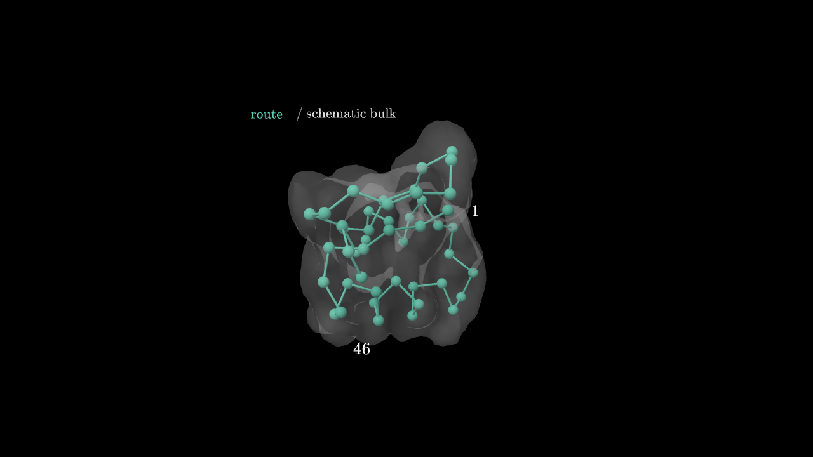
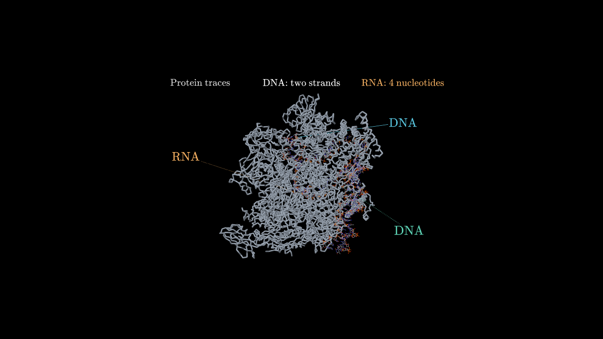
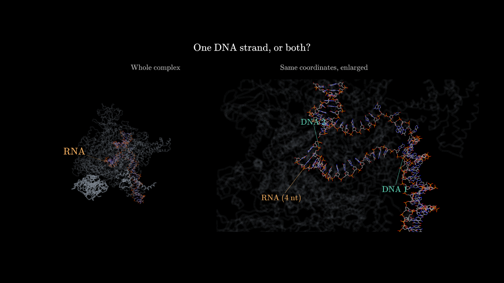

# Molecular representation choice

Two fresh production lessons completed. The orchestrator selected different molecular representations for different teaching goals; final sources and comparative evidence are retained here.

## Change and ownership

Base: target repository main at 7e3df304a8efb13d2ce3fed9baa089e5e5cdf138. Local integration branch: codex/molecular-representation-choice.

Coordinated with Add video creation progress estimate (01a12a2f-e8af-7811-96a3-ba3af6a85763). The accurate large-complex importer and prepared crambin alternatives already existed in merged main. Imported only that chat's optional molecular landmarks and two corresponding tests: backend/src/bundled-models.ts, backend/src/molecular-models.ts, backend/test/molecular-models.test.ts. Geometry and element colors remain unchanged; converter version is rcsb-deposited-v2. No unrelated progress, loading, retry, release, or deployment edits were copied.

The orchestrator records the chosen representation, teaching purpose, source identity, and overview/focus correspondence in existing scene fields. It can choose substantial deposited complex geometry, a faithful shape/chain simplification, or local atomic detail. There is no mandatory tour and no new binary rendering-mode schema. Crambin fixtures cannot substitute for another named molecule.

A real failed iteration showed that full context can hide a small target. Planning now exposes the target before asking the learner to inspect it; craft and review allow a faithful cutaway, reduced foreground visibility, or linked close-up. Preserve the spatial comparison, coordinates, element colors, and a complete default explanation. Native Rotate/Move/Reset remain available; explanations stay fixed while object labels follow actual sites.

## Evidence scope

Requests in this directory specify concepts and molecular identities without prescribing a renderer or prepared fixture. scripts/visual-quality-smoke.ts runs fresh production planning, editorial review, publication, authoring, and native visual review using configured Codex subscription, gpt-6-astra/high, subtitle timing, and actual animlib. Generated source is not hand-edited.

Prior protein: docs/validation/visual-quality-recovery/README.md. Prior complex: collaborating chat's refined source hash f766a8b4ff29c6b814b49c9cd0d5e82e0dc85da8d5adeedd3f3d222c53c3b848, model b395b900e5008e039b988a865814311a9d55cc5ff1bf0675b01621265236e450. That complex example resumed an insertion and was manually refined; it is a visual reference, not proof of fresh orchestration.

Final reruns use the same requests as preceding integration iterations. One run per condition demonstrates capability and observed differences, not a statistical reliability estimate. Native frames cannot alone prove live navigation. These are interactive subtitle lessons, not encoded movie exports.

## Scientific limits

[4YLN](https://www.rcsb.org/structure/4YLN) is an E. coli transcription initiation complex, not eukaryotic polymerase II. Its 5.50-Angstrom deposition has a nucleotide-linkage caveat. The importer preserves retained deposited coordinates and gaps, renders protein CA traces and nucleotide heavy atoms, and does not reconstruct biological assemblies, missing atoms, exact protein surfaces, or molecular dynamics.

Landmarks are retained atom sites in model-local Angstrom coordinates with the common origin already subtracted. They are not inferred active sites. First/last refer to retained source order, not biological termini. Separate chain selections can have different origins: prefer selecting parts in one asset, or align source frames explicitly.

## Safe integration

Keep merged main's newer prompts and deployment opt-in guard. If the other chat later integrates its remaining release work, merge the landmark additions only once; its pre-merge base was 90e8a8d. Do not restore its whole worktree over this branch. Re-run molecular/publication tests and inspect generated examples after resolving overlapping prompt changes.

No push or deployment is part of this coordination change. Full run and asset fingerprints live in audit.json; bulky raw provider logs and render batches remain in local data/molecular-representation-choice.

## Measured results and comparison

| Case | Earlier iteration | Final fresh pipeline |
| --- | --- | --- |
| Crambin connectivity | protein-v1 completed with beads and envelope; no forced atomic tour | protein-v2 completed, 80.534 s. Same two model hashes. Endpoint numbers persist, sequence highlight precedes the question, and the aligned envelope is explicitly hidden/restored to compare representations. |
| 4YLN spatial relationship | complex-v2 asked about buried RNA before exposing it; three visual reviews rejected occlusion, then the run was cancelled | complex-v3 completed, 74.434 s. Same 90,004-triangle, 12-part GLB. Whole-complex view leads into a linked close-up with faint foreground before the question and five-second pause. |

Final protein needed two automatic label repairs in scene 0 and two structural-validation retries during scene 1 authoring. Scene 1 passed its first visual review. Final complex needed one automatic visual repair per scene: heading/label separation in scene 0; label clipping, fixed-text bands and a question/answer crossfade in scene 1. Each final production review approved. These repairs are part of the real pipeline; generated scene source was not hand-edited. Generation elapsed approximately 13.1 and 23.6 minutes respectively, not a performance benchmark.

Native proof renders cover 1280x720 and 960x720, including dense sequence-highlight and question-to-answer transition samples. Root tested actual WebGPU playback, scene handoffs, Rotate/Move/Reset, protein-envelope toggle and complex-context toggle. Complex overview and close-up rotate independently. Fixed explanations/captions stay fixed; attached molecular labels move with their anchor. Context toggle hides close-up foreground while retaining the overview.

Limits: a downward protein orbit can clip endpoint label 46 at the viewport edge; pan/reset restores it. Native default views passed. Two browser-automation clicks timed out during complex playback; playback nevertheless progressed through scene 2 to its end, and paused inspection remained usable. This is not proof of smooth interaction on every machine or every camera pose.

Validation: 336 backend tests, 0 failures, 15,722 assertions; backend TypeScript check passed; independent focused molecular/bundled/publication run passed 14 tests. No renderer or frontend production code changed. Independent visual review is recorded separately in review.md. Raw frame manifests remain under data/molecular-representation-choice/proof; final sources, plans, model metadata and production verdicts are retained beside this document.

Local preview: http://127.0.0.1:5241/ (requires the running local gallery). Its selector includes prior protein examples and both final lessons. It uses actual animlib with silent subtitle clocks, not an encoded video.

## Repeat the production check

From the repository root, set AGENT_PROVIDER=openai-codex and PI_CODING_AGENT_DIR to the existing configured agent directory. Run scripts/visual-quality-smoke.ts with the tracked protein-request.json or complex-request.json and a new, non-existent output directory. Use the repository's installed Bun executable if Bun is not on PATH. This uses the configured subscription and may make fresh asset/source requests.

Compare final plan, sources, model hashes, repair history and rendered frames against audit.json, not only whether generation returned success. For complex context, check the RNA target before and throughout the invitation/pause; for protein continuity, check the traveling emphasis, fixed conformation, aligned envelope and scene handoff. Keep the deposition's fidelity limits and verify Rotate/Move/Reset in live playback separately from native frame review.
