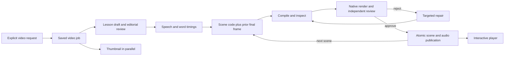

# Observed RNA transcription video generation — 15 October 2026

Status at report build: **complete**. Video ID: `a8857393-44f8-45dd-8a1e-ec5b7b601454`.
Player: http://127.0.0.1:47831/watch/a8857393-44f8-45dd-8a1e-ec5b7b601454
Request accepted 21:00:00 Europe/Zurich (2026-10-15T19:00:00.291Z). Completed 21:25:52; total wall time 1552.566 seconds.

## What was requested

The user’s “ran transcription” was interpreted as RNA transcription and that assumption was stated before submission. This run requested a narrated English beginner explanation, roughly 60–90 seconds, approximately three scenes, accurate strand directions and complementary pairing, continuous visual reasoning, schematic biology, and the normal mandatory review gates. No source documents or images were attached.

Exact submitted topic:

> Create a narrated English explanatory video about RNA transcription for a curious beginner. Aim for roughly 60–90 seconds and about three coherent scenes: how a DNA template is selected and opened; how RNA polymerase builds complementary RNA with clear strand directions; how transcription ends and the RNA is released. Distinguish transcription from DNA replication and translation without adding separate lessons. Use original 3Blue1Brown-style continuous visual reasoning: large readable biological construction, persistent strand/base identities and semantic colors, local labels tied to their objects, visible operations that earn each claim, purposeful motion and reading holds. Show template versus coding strand, complementary pairing including uracil, and 3-prime/5-prime direction accurately. Use honest clearly schematic biological representations; do not invent atomic geometry or imply a specific species-dependent mechanism is universal. Keep initiation/termination appropriate to the stated scope. Preserve the real Aha pipeline, default narrated audio, mandatory independent storyline and rendered-scene reviews, and useful interaction where it helps. Do not turn this into lecture notes or a slideshow. The user is studying how this pipeline works, so normal saved generation artifacts and diagnostics must remain available.

## Which software ran

This run used installed Aha Video plugin 0.2.0, not the current repository checkout. The earlier notes/video separation refactor is saved in the checkout but was not deployed into this packaged engine. This observation therefore demonstrates the installed video path; it does not prove the new configuration boundaries are running.

Runtime: `C:\Users\samue\.codex\plugins\cache\aha-local\aha-video\0.2.0\runtime`. State: `C:\Users\samue\.aha\video-plugin`.
Main model: gpt-6-astra, high reasoning, openai-codex subscription authentication. Thumbnail: gpt-6.1-sol, low reasoning. Speech: ElevenLabs eleven_multilingual_v2. Scene output mode: validated-reference; timing mode: host.

## What happens, in order

1. The plugin normalizes the request, assigns a video UUID, and persists it with an idempotency key. Retrying the same key retrieves the same job rather than intentionally creating another video. A background worker starts the durable job.
2. Source preparation collects attached documents and images. This run had none, so this stage completed in 1 ms.
3. A thumbnail request starts concurrently with storyline generation. The main model produces a structured lesson: three beats, narration, visible operations, carry-over object identities, cleanup rules and planned interactions. This is internal video planning, not lecture-note synthesis.
4. A fresh editorial-review conversation checks the lesson. This run passed on its first review, with a non-blocking warning that the requested duration might be tight. The approved lesson and readable script are saved.
5. Narration service synthesizes each beat, records real word timings, and saves 24 kHz WAV audio. Scene one becomes eligible as soon as its own audio is ready; later narration continues in parallel with scene-one authoring. Total measured audio: 77.368875 seconds.
6. The scene author receives the approved plan, actual narration timings, animation API/reference material, style instructions, and the previous scene’s final frame. It writes executable animlib JavaScript, rather than asking an image model to paint a movie. Host timing owns the authoritative duration and word lookup.
7. Compilation, timing, planned-interaction, inherited-state and layout checks reject invalid candidates. The author can inspect analytical geometry and request native preview frames. Failed candidates receive concrete diagnostics and retry. A validated candidate ID prevents the final response from needlessly reproducing its full source.
8. A separate review stage sees native renders at both 1280×720 and 960×720, arranged into contact sheets, plus the configured style reference and timing/source context. Each observed gate round samples 12 times per size. A rejection triggers a targeted source repair, another render, and another review. Passing a compiler alone does not publish the scene.
9. Once approved, scene source and audio are committed atomically to the video database, then a publication event updates the player. The next scene starts from the previous final frame. Scene generation is sequential; approved script and completed audio are reused.
10. After every scene is published and thumbnail work is finished, the worker marks the manifest complete. The normal deliverable is an interactive browser lesson with generated code and audio; this run does not inherently export an MP4.

## Measured narration

| Scene | Content | Audio seconds | Aligned words |
| --- | --- | ---: | ---: |
| 1 | Choose a template | 22.058958 | 57 |
| 2 | Copy in the opposite direction | 32.507917 | 81 |
| 3 | Release the message | 22.802000 | 53 |

## Observed event timeline

Times are Europe/Zurich. Elapsed seconds start at video.queued. Scene indices below are human-facing, starting at 1. Attempt numbers remain exactly as logged. Durations overlap where work runs concurrently; do not add them to estimate wall time. Routine 30-second stage.running heartbeats are retained in raw evidence but omitted below.

| Local time | Elapsed s | Event | Stage | Scene | Attempt | Duration s |
| --- | ---: | --- | --- | ---: | ---: | ---: |
| 21:00:00 | 0.000 | video.queued |  |  |  |  |
| 21:00:00 | 0.002 | video.started |  |  |  |  |
| 21:00:00 | 0.005 | stage.started | sources |  |  |  |
| 21:00:00 | 0.006 | stage.completed | sources |  |  | 0.001 |
| 21:00:00 | 0.009 | stage.started | thumbnail |  |  |  |
| 21:00:00 | 0.032 | stage.started | script |  |  |  |
| 21:00:01 | 0.722 | stage.started | draft |  | 1 |  |
| 21:00:19 | 19.509 | stage.completed | thumbnail |  |  | 19.500 |
| 21:03:04 | 183.893 | stage.completed | draft |  | 1 | 183.172 |
| 21:03:04 | 183.901 | stage.started | review |  | 1 |  |
| 21:03:39 | 218.894 | stage.completed | review |  | 1 | 34.993 |
| 21:03:39 | 218.895 | script.approved |  |  | 1 |  |
| 21:03:39 | 218.895 | stage.completed | script |  |  | 218.863 |
| 21:03:39 | 218.906 | narration.queued |  |  |  |  |
| 21:03:39 | 218.907 | narration.started |  |  |  |  |
| 21:03:39 | 218.907 | stage.started | narration | 1 |  |  |
| 21:03:39 | 218.908 | narration.speech_started |  |  |  |  |
| 21:03:43 | 223.194 | narration.speech_completed |  |  |  | 4.286 |
| 21:03:43 | 223.198 | narration.scene_ready |  | 1 |  |  |
| 21:03:43 | 223.198 | narration.speech_started |  |  |  |  |
| 21:03:43 | 223.339 | stage.completed | narration | 1 |  | 4.432 |
| 21:03:43 | 223.356 | stage.started | scene | 1 |  |  |
| 21:03:49 | 229.041 | narration.speech_completed |  |  |  | 5.843 |
| 21:03:49 | 229.045 | narration.scene_ready |  | 2 |  |  |
| 21:03:49 | 229.045 | narration.speech_started |  |  |  |  |
| 21:03:53 | 232.744 | narration.speech_completed |  |  |  | 3.699 |
| 21:03:53 | 232.747 | narration.scene_ready |  | 3 |  |  |
| 21:03:53 | 232.753 | narration.completed |  |  |  | 13.847 |
| 21:05:21 | 321.359 | scene.inspected |  | 1 |  | 0.464 |
| 21:05:27 | 326.839 | scene.previewed |  | 1 |  | 1.356 |
| 21:06:28 | 388.012 | scene.inspected |  | 1 |  | 0.366 |
| 21:06:32 | 392.038 | scene.previewed |  | 1 |  | 0.655 |
| 21:06:36 | 396.136 | stage.completed | scene | 1 |  | 172.785 |
| 21:06:38 | 398.443 | stage.started | review | 1 | 0 |  |
| 21:07:07 | 427.044 | stage.completed | review | 1 | 0 | 28.602 |
| 21:07:07 | 427.047 | stage.started | repair | 1 | 0 |  |
| 21:07:45 | 465.220 | stage.completed | repair | 1 | 0 | 38.174 |
| 21:07:47 | 467.261 | stage.started | review | 1 | 1 |  |
| 21:07:57 | 476.766 | stage.completed | review | 1 | 1 | 9.506 |
| 21:07:57 | 476.865 | video.scene_published |  | 1 |  | 476.870 |
| 21:07:57 | 476.872 | script.reused |  |  |  |  |
| 21:07:57 | 476.878 | stage.started | narration | 2 |  |  |
| 21:07:57 | 476.879 | stage.completed | narration | 2 |  | 0.001 |
| 21:07:57 | 476.884 | stage.started | scene | 2 |  |  |
| 21:09:31 | 571.375 | scene.validation_failed |  | 2 | 1 |  |
| 21:10:18 | 618.166 | scene.validation_failed |  | 2 | 2 |  |
| 21:11:56 | 715.776 | scene.validation_failed |  | 2 | 3 |  |
| 21:13:23 | 802.826 | scene.validation_failed |  | 2 | 4 |  |
| 21:14:25 | 865.286 | scene.inspected |  | 2 |  | 0.624 |
| 21:14:31 | 870.840 | scene.previewed |  | 2 |  | 0.899 |
| 21:16:09 | 969.064 | scene.previewed |  | 2 |  | 0.867 |
| 21:16:14 | 973.953 | stage.completed | scene | 2 |  | 497.084 |
| 21:16:16 | 976.092 | stage.started | review | 2 | 0 |  |
| 21:17:06 | 1025.721 | stage.completed | review | 2 | 0 | 49.630 |
| 21:17:06 | 1025.724 | stage.started | repair | 2 | 0 |  |
| 21:17:58 | 1077.763 | scene.validation_failed |  | 2 | 5 |  |
| 21:19:22 | 1161.972 | scene.validation_failed |  | 2 | 6 |  |
| 21:19:45 | 1184.995 | stage.completed | repair | 2 | 0 | 159.276 |
| 21:19:47 | 1187.143 | stage.started | review | 2 | 1 |  |
| 21:20:09 | 1209.554 | stage.completed | review | 2 | 1 | 22.412 |
| 21:20:09 | 1209.556 | stage.started | repair | 2 | 1 |  |
| 21:20:34 | 1234.450 | scene.validation_failed |  | 2 | 7 |  |
| 21:21:16 | 1276.028 | scene.validation_failed |  | 2 | 8 |  |
| 21:22:03 | 1323.028 | stage.completed | repair | 2 | 1 | 113.474 |
| 21:22:05 | 1325.160 | stage.started | review | 2 | 2 |  |
| 21:22:27 | 1346.892 | stage.completed | review | 2 | 2 | 21.732 |
| 21:22:27 | 1346.952 | video.scene_published |  | 2 |  | 1346.982 |
| 21:22:27 | 1346.960 | script.reused |  |  |  |  |
| 21:22:27 | 1346.965 | stage.started | narration | 3 |  |  |
| 21:22:27 | 1346.966 | stage.completed | narration | 3 |  | 0.001 |
| 21:22:27 | 1346.974 | stage.started | scene | 3 |  |  |
| 21:23:58 | 1438.350 | scene.validation_failed |  | 3 | 1 |  |
| 21:25:02 | 1501.721 | scene.inspected |  | 3 |  | 0.578 |
| 21:25:08 | 1508.465 | scene.previewed |  | 3 |  | 0.674 |
| 21:25:22 | 1522.654 | stage.completed | scene | 3 |  | 175.684 |
| 21:25:25 | 1524.835 | stage.started | review | 3 | 0 |  |
| 21:25:52 | 1552.497 | stage.completed | review | 3 | 0 | 27.662 |
| 21:25:52 | 1552.555 | video.scene_published |  | 3 |  | 1552.589 |
| 21:25:52 | 1552.561 | script.reused |  |  |  |  |
| 21:25:52 | 1552.566 | video.completed |  |  |  | 1552.600 |

## Failures and review findings

Scene one’s first rendered review rejected a causal timing problem: the promoter disappeared before polymerase recruitment, leaving an unconnected direction arrow during the orientation explanation. A targeted repair retained and connected the promoter through that passage; the next review approved it.

Scene two’s accumulated validation diagnostics initially reported (in order): competing reactive/timeline ownership of the same property; missing planned polymerase drag interaction; and a reading label overlapping RNA bases at 8.150 seconds. These diagnostics are accumulated history, not proof that all remained present in the latest candidate.

- scene-0.visual/0/review.json: rejected. 15.035s: The promoter disappears before polymerase recruitment starts. When narration explains that its orientation selects the template, only a detached transcription arrow remains; the promoter's orientation and its relationship to recruitment are never shown together. Repair requested: Retain the promoter through recruitment and the orientation explanation. Associate the rightward cue visibly with its bracket, then remove both before the local opening, keeping labels clear of polymerase.
- scene-0.visual/1/review.json: approved. 
- scene-1.visual/0/review.json: rejected. 31.684s: The planned polymerase-driven replay is not implemented. Dragging only offsets the enzyme and springs it back; copying progress, DNA opening, RNA and count depend on the slider/time instead. The default enzyme descendants are also unpickable paths/text. During slider replay, the enzyme's timeline returns toward completion while the other geometry holds the selected progress. Replay is disabled on the final held frame. Repair requested: Implement a pickable progress interaction that drives the enzyme, opening, RNA, pairing, end labels and count from one shared state. Keep exploration usable while paused at the completed picture, and restore the canonical six-base state for handoff without disabling final-frame exploration.
- scene-1.visual/1/review.json: rejected. 32.50791666666667s: The polymerase is now pickable and replay remains available at the final frame, but the core interaction defect persists: dragging the enzyme only offsets it and springs it back. DNA opening, RNA incorporation, pairing, terminal labels and count still depend exclusively on slider/time progress, so dragging separates the enzyme from its active site instead of revisiting copying states. Repair requested: Replace the independent spring-return gesture with a supported shared-progress interaction that synchronizes polymerase and all copying geometry/readouts. Use parameter-driven reconstruction if necessary rather than retaining a disconnected enzyme drag. Preserve final-frame exploration and the canonical completed handoff.
- scene-1.visual/2/review.json: approved. 
- scene-2.visual/0/review.json: approved. 

## Usage and observation limits

Observed scene-validation rejections: 9. Rendered review rounds: 6; editorial review rounds: 1; targeted visual repair stages: 3.

Reported input tokens: 2,317,344; output: 59,648; total: 2,376,992. Final manifest usage. Input includes cache-read/cache-write accounting; it is not a count of unique prompt words or a dollar bill. In-flight estimated output is excluded from these reported totals.

This trace combines job-specific backend events, two-second manifest snapshots, saved lesson/audio/scene artifacts, reviewer verdicts, source inspection and browser checks. It does not expose private model reasoning or an exhaustive transcript of every internal model tool call. A sampled-frame approval also does not prove every continuous transition or interaction is flawless.

Local player verification during generation: first-scene playback advanced to its 22-second boundary; seeking to 11 seconds displayed the DNA/promoter construction. The embedded MCP player loaded but its synthetic play interaction did not advance the timeline. Acoustic output was not independently listened to by the agent; saved narration and word timings were inspected.

After scene two was published, the local player exposed an exploration toggle and progress slider. At the paused final state, enabling exploration and changing progress from 6 to 3 rebuilt the visible enzyme position, opening, RNA chain and incorporated count together (3/6). The parameter rebuild was asynchronous: the first immediate screenshot still showed 6/6, while the settled screenshot showed the selected 3/6. This tests slider-driven replay, not direct dragging of the enzyme. The final author used the supported parameter-control fallback and constrained direct enzyme dragging to its selected site.

Independent visual audit found a diagonal RNA connector crossing glyphs in an early draft. Rechecking the published scene-two candidate at 1280×720 and 960×720, at local 12.736, 16.649, 20.8115, 24.532 and 32.507917 seconds, confirmed the connector now clears the glyphs. See independent-review.md in the trace directory. This narrow resolution does not certify every transition.

Final local playback check: the player transitioned into scene three, advanced through global 73.6 seconds, reached the 77.37-second end/replay state, and was reset to the beginning for the user. The completed player displays 1:17. The stored sources exactly match both the published manifest and SHA-256 values in their approved rendered-review receipts; verification.json records those checks.

Unresolved capture discrepancy: scene-2.visual/0/1280x720-9.png (scene-local 18.565 seconds) contains large black regions obscuring geometry. The actual local player near that time (global 73.1 and 73.6 seconds) showed the complete construction. Directly reopened final-frame PNGs at both 1280×720 and 960×720 are clean. A reviewer’s initial claim that both final endpoints were also erased was retracted after individual reinspection. The evidence supports a saved-render/capture discrepancy, not a demonstrated persistent defect throughout the shipped video; its cause was not diagnosed or fixed in this observation. The automated visual reviewer approved this scene despite the affected saved frame. Independent final assessment: reasoning/readability ready within inspected scope; overall reference-style motion and technical delivery remain qualified/unverified because continuous/acoustic coverage and the capture discrepancy are unresolved.

The full-video job did not invoke the lecture-notes synthesis path. Its internal script.md is video narration/planning, not a notebook record. Workflow separation in the checkout is explained in ../notes-video-architecture.md.

## Evidence locations

- Local trace: C:/Users/samue/Stuff/3yellow3white/.tmp/rna-transcription-trace
- Job artifacts: C:\Users\samue\.aha\video-plugin/agents/a8857393-44f8-45dd-8a1e-ec5b7b601454
- Narration: C:\Users\samue\.aha\video-plugin/narration/c9b4514d0f654f196ae89f2d605505c3abbf413eab800345042225f1962ef294
- request.json: exact submitted request and idempotency key.
- configuration.json: deliberately allowlisted runtime/model configuration; no credentials.
- all-events.jsonl: all matching backend events, recovered from the complete log after monitoring.
- snapshots.jsonl: changing manifests sampled during generation.
- summary.json: stages, publications, reviews, metrics and artifact paths.
- manifest.json: latest scene sources, timings, audio URLs, progress and usage.

No production source or plugin runtime was modified for this observation. The plugin backend remains running for playback.
