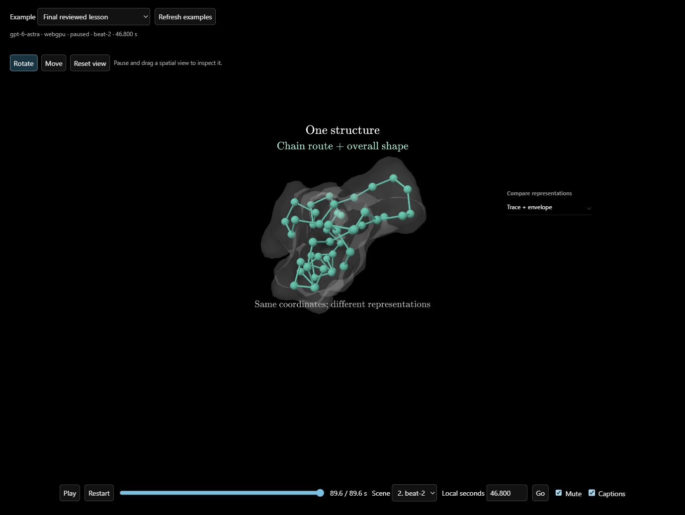

# Visual-quality recovery and merge handoff

Target: `SamuelHitzinger/3blue1brown-Visuals`, PR #1. Base: `90e8a8d0308b25700062561ce79d73885754fe98`, the latest original `main` fetched for recovery. The original repository and its checkout are unchanged.

## Why the earlier integration failed

Git accepted the old merge; CI failed six molecular tests because their fixture used `mkdtemp` under an ignored `.aha` directory that existed locally but not in a clean checkout. Reproduced all six failures from an empty working directory. Moving the test root to `os.tmpdir()` makes all six pass without local cache assumptions.

Independent review also found legacy editorial audit recovery still accepted only rounds 0–2, although current main allows 50 rounds and prunes older checkpoints. A round-12 regression failed before the fix and passed afterward. Keep this fix with the restored recovery code.

## Changes to preserve

- Consolidated `guidance.md` and `scene-craft.md` remain the active owners. Setting, guided observation and visible reasoning precede essential formalism. Retire stale annotations; worked examples may use as many equations as their current step needs.
- Planning specifies why 3D matters and the defining geometry, relationships and operations. Scene authoring and rendered review retain that standard. Models must be recognizable and scientifically grounded; complexity alone is not evidence.
- Molecular preparation preserves source identity, coordinates, topology and element colors. Prepared envelopes and residue beads are explicitly schematic. Planning can prepare models before committing to their geometry; scene authoring owns presentation.
- New interactive 3D views support Rotate, Move and Reset. Explanations remain in screen space; referent labels belong to their model. Keep frontend controls, playback reconciliation and animlib interaction/renderer changes together.
- Preserve latest main's direct manipulation, archive/title UI, consolidated prompts and 50-round persisted recovery. Preserve restored progress/loading/model-publication changes and their shared contracts. Rebuild generated frontend bundles instead of resolving them with whole-file ours/theirs.
- Deployment is opt-in with repository variable `DEPLOY_ENABLED=true` and the new repository's own host/secrets. Tests and Docker packaging run without enabling deployment.

The historical `docs/amilibsam-merge-handoff.md` describes the earlier snapshot. Do not cherry-pick that old snapshot over this recovery branch or reintroduce its `.aha` fixture assumption.

## Verification

Clean installs used committed lockfiles. Local restored suites passed: 1,105 animlib, 333 backend and 84 frontend tests, plus builds/typechecks. The later recovery regression adds one backend test. The focused run after `37a2766` passed 20 tests across prompt assembly, model planning, audit resume and molecular preparation.

Ubuntu CI at `1732fd1331b4ad315bfcc844f29d93dfc0d4e73e` passed the full workflow, including Docker lifecycle and packaging: https://github.com/SamuelHitzinger/3blue1brown-Visuals/actions/runs/38414851572. Windows cannot validate Linux file-mode/deployment semantics and had no running Docker daemon; Linux CI supplies that evidence.

## Production-pipeline comparisons

Exact same protein request and `gpt-6-astra`/high settings as October 11 reference. Fresh planning, editorial review, model publication, scene generation and native WebGPU review ran through production modules. No seeded plan or hand-edited generated scene. Subtitle-only output uses silent timing audio, so this does not test speech synthesis.

| Iteration | Result compared with prior iteration |
| --- | --- |
| October 11 reference | 84.8 seconds, two scenes. Source-derived protein geometry; some unnecessary molecular terminology. Historical style reference, not a randomized control. |
| Restored pipeline | 92.034 seconds, two scenes. Clearer teal chain against gray envelope, but persistent credits and representation labels increase clutter. Native review repaired two overlap findings. Live narrow-aspect inspection revealed further label crowding. |
| Clarity refinement | Removed persistent credits and explained amino-acid beads more directly. Still used unnecessary alpha-carbon/CA terminology. Independent review requested a targeted correction. |
| Final prompt | 89.634 seconds, two scenes. Alpha-carbon jargon and persistent credits removed; introductory title retires. Independent review found a clipped gesture hint missed by automatic approval. |
| Reviewed delivery | Same complete lesson, followed by targeted production repairs removing both drawn gesture hints; live rotation exposed the second hint after the first repair. Both repaired scenes revalidated and natively re-reviewed with the repaired handoff; geometry and timing preserved. |

Final planning/authoring commit `37a2766` keeps source/preparation details in metadata or brief closing credits, uses learner vocabulary for representation meaning, retires introductory titles and reserves room around navigable models. Independent prompt review found no new scientific-fidelity contradiction. Commit `ef9f5c3` then clarified the observed viewport-clipping cause in authoring and verification prompts. The full fresh run used `37a2766`; the targeted delivery repair used the revised scene guidance, its original approved plan and narration, and explicit independent findings. This last repair is not another fresh planning run.

`audit.json` records exact request/source/prompt/asset hashes and verifies that each generated source matches its approved native review. Generated logs and task context remain in ignored `data/visual-quality-recovery`; selected screenshots and final generated source are retained here for portable review. These are individual iteration comparisons, not statistical evidence or a guarantee for every topic.

Known limit: narration retains brief “bond order” and “electron-density map” caveats. Independent editorial review found these optional wording improvements, not missing steps in the central inference. Native stills do not certify all motion; live tests supplement them. The comparison gallery uses the real animlib player and production-style canvas fit, not the complete React app.

## Final visual and interaction checks

Independent review accepted reasoning, sampled readability and reference style after both hint repairs. Native frames cover 1280×720 and 960×720. Live gallery checks confirmed model rotation and panning while the element legend stays fixed, Reset restores the authored view without advancing paused time, and playback resumes. All three published GLB hashes match the October 11 reference. No new scientific model was substituted.

Portable navigation evidence: [before rotation](browser-before-orbit.png), [after rotation](browser-after-orbit.png), [after pan](browser-after-pan.png). Native evidence: [chain](final-scene-0.png), [atoms](final-scene-1.png), [earlier lesson](previous-protein.png).

## Merge procedure

Merge the recovery PR into the new repository's main after final CI and visual review. For overlapping work on another branch, merge source deliberately: keep molecular fixtures in OS temporary directories, preserve 50-round recovery bounds, combine shared progress contracts and player/renderer changes, then rebuild bundles. Run root build/typecheck/tests, backend typecheck/tests, frontend tests/build, and Linux deployment/container checks. Keep unrelated research changes separate.
